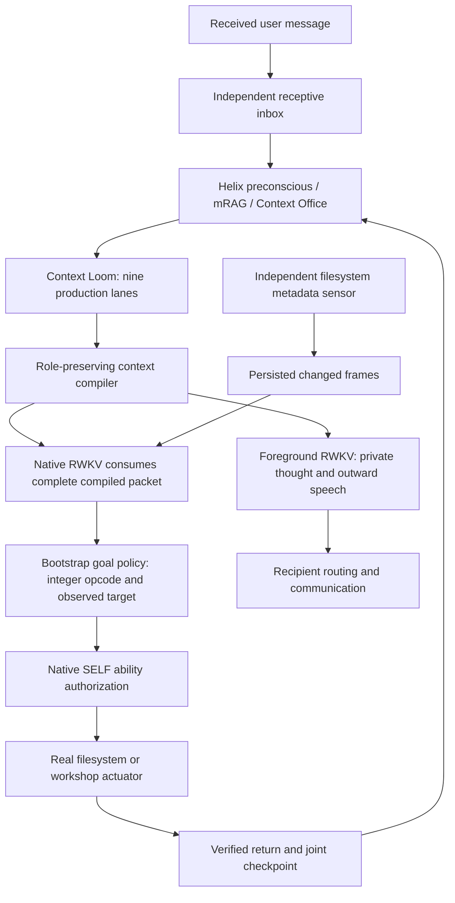

# Helix AGI

A local Dual RWKV agent runtime combining a persistent RWKV/Habitus mind, a foreground
RWKV language stream, role-separated memory retrieval, and a filesystem body.

**Documentation reviewed: 2026-10-17, `main` plus the current working-tree
changes.** The recent motor implementation is not yet a tagged release.

The current `mindscape` composition can receive explicit movement, inspection,
file-open and Python-run requests independently of language generation. Its
actuators receive integer motor signals bound to observed targets. Foreground
speech has no execution authority and requires no model function calls.

This is an operational bootstrap policy. Learned motor selection, open-ended
autonomous exploration, general conversational coherence and developmental
growth have not been established by the latest trial.

## TL;DR: start the selected Dual RWKV agent

For an existing configured agent:

```bash
venv/bin/python main.py
```

The normal entry point uses the selected `data_dir` in `config/config.json`.
An explicit `--data-dir` overrides it; changing only the data directory does
not create a matching identity or home.

For a new installation, prepare Python 3.11+, Linux with working Bubblewrap/user
namespaces, Ollama, a compatible MightyMem source checkout and the pinned RWKV
checkpoint. The current native bridge runs on CPU.

```bash
python3 -m venv venv
venv/bin/python -m pip install -r requirements-mindscape.txt
ollama pull qwen3-embedding:0.6b
# Keep the Ollama service running.
./install.sh
```

The graphical wizard guides identity, archetype, memory seed/voice, model,
main communication channel, credentials, tools, safety and schedule. It
provisions the named home and creation manifest. Point it to the actual
MightyMem source and RWKV model directories.

For explicit command-line creation, use the
[launch guide](documents/mindscape_launch.md#command-line-creation). That guide
includes the provisioning step currently missing from the CLI. Specify
`--provider rwkv` when selecting Mindscape from the command line; the
composition flag alone does not reliably choose RWKV.

```bash
# Loads, synchronizes and checkpoints real state; initialization check only.
venv/bin/python main.py --check-setup
# Start the selected agent.
venv/bin/python main.py
# Start the dashboard in another terminal.
venv/bin/python dashboard/dashboard.py --port 5050
```

Open `http://127.0.0.1:5050`. The GUI launcher can manage the dashboard; plain
`main.py` does not automatically launch its HTTP server. The October 17 local
trial used port `15219`; that port and its agent name are trial settings.

## Interact with the body

Use Dashboard Chat, then expand **Environment and actions** for actual file
contents, stdout, exit status and errors independently of a language reply.
Upload a Python file through staging and place it in the selected home's
`workshop/` before requesting execution.

```text
Please go to /thinking then go to /workshop.
Please open /bedroom/closet/CaseNotes.txt.
Please open /staging/FirstNote.txt and /staging/SecondNote.txt.
Please go to /workshop then open Example.py then run it.
Please sense .
```

Paths are relative to the agent home, preserve case, and can be quoted when
they contain spaces. `it` refers to an explicitly opened file earlier in the
same request. The current receptor recognizes explicit positive commands;
ambiguous and negated requests receive no guessed action or generated program.
The receptor does not yet expose arbitrary file creation, module activation,
web browsing or sleep commands.

Python execution requires a matching observation of the script's SHA-256.
Only the workshop is writable inside its Bubblewrap process. The sandbox
isolates network and process namespaces and does not mount the bedroom,
source checkout or mind stores. It never falls back to host execution.

## Runtime and evidence flow



The native owner serializes neural state, graph access and actuators. A separate
sensor continues sampling the current room during foreground generation and
sandbox execution. Changed frames persist under `intakes/` and queue for native
admission; an active actuator can delay that admission. Each sampling tick has a
receipt, including unchanged observations.

The motor route must traverse real persistent memory, all production retrieval
lanes, the compiler and the declared native model before actions are released.
A successful goal becomes publicly complete only after every requested target
has a verified return and a matching joint neural/memory checkpoint commits.

## Agent home and persistence

Creation uses the user-entered name:

```text
data/
  homes/<Agent Name>/
    thinking/             initially empty room
    modules/              installed operational scripts
    bedroom/
      sleep.json          production dream-engine interface descriptor
      closet/             personal files
    workshop/             isolated experiments and artifacts
    staging/              dashboard uploads, created when used
    intakes/              controller-owned text/JSON observations
    home.json
    identity.json
  agents/<Agent Name>/
    creation.json
    beliefs/              canonical category stores
    memory/               append-only journal
    spatial/              semantic index and spatial state
    mindscape/            Loom projection, receipts, motor state, joint checkpoints
```

Archetypes `balanced`, `curious`, `deliberate` and `builder` seed native
preferences through gestation. They do not train neural weights or guarantee
skills. Starter memory depth and voice wording are separate choices. Existing
gestation cannot be rewritten by changing the setup name or archetype.

See the [agent-home contract](documents/agent-home.md) for room focus,
remembered modules, containment and current activation limits.

## Models, memory and configuration

| Setting/component | Current Mindscape behavior |
|---|---|
| Native mind | MightyMem `ContinualMind`: persistent RWKV, 18,016,166-parameter Habitus cortex and graph |
| Foreground | Local RWKV using the declared checkpoint; optional Ollama foreground is a separate configuration |
| Verified checkpoint | `RWKV/RWKV7-G1j-1.5B-20260831@2c18b29ab7fbece25ff6112281eea0fa41fcb30f` |
| Auxiliary language work | Selected local provider; configured-provider failure cannot fall through to Gemini |
| Semantic retrieval | Local Ollama `qwen3-embedding:0.6b`, native 1024D embeddings |
| Other retrieval | Exact/recent evidence, subjective and procedural material, corrections, graph and spatial associations |
| Compiler | Preserves producer roles, source IDs and evidence labels; admits whole contributions |
| `local_context_window` | Configured assembled-input budget, normally 8192; this is not RWKV's physical recurrent capacity |
| `mindscape.action_intent_source` | `native_motor`; old speech-action aliases migrate to this value |
| `mindscape.sensory_interval_seconds` | Configurable observation cadence, default 1.0 seconds |
| `task_cognition_mode` | `off` in the supported native profile; keep `HELIX_TASK_COGNITION` unset/off; legacy task execution is separate |

The RWKV route has no generated-output cap, action-count ceiling or workshop
execution timeout. Input-budget overflow and provider failure are explicit;
unfinished output is not fabricated into a successful reply. Other provider
and diagnostic routes retain inherited limits and need their own audit.

The verified local composition also depends on changes in the configured
MightyMem source, including cooperative native shutdown. Installing this Helix
checkout alone does not reproduce that dependency state. Sources, hashes,
weights and boundaries are recorded in the
[October 17 composition manifest](documents/audits/2026-10-17-native-body-operational/handoff/composition-manifest.json).

## Verified behavior and unfinished work

The [October 17 operational record](documents/audits/2026-10-17-native-body-operational/README.md)
documents a normal `main.py` launch, graceful restart, and a five-action
workflow: move, move, open, run, open. Receipts connect the actual nine-lane
context to native model admission, SELF authorization, full file/hash read-back,
a real Python artifact and a joint checkpoint before completion. A host-write
sentinel remained unchanged. Separate earlier controls recorded sensing during
a running script and rejection of a negated request.

The recorded **72 focused implementation checks** are separate diagnostics.
They are not a product score or a measure of recall, coherence or growth.

The nursery in `core/nursery/` is a separate prototype. It is not called by
normal setup, the wizard or runtime startup. Its default generator uses
host-coded responses, utility execution is simulated, and sleep persistence
does not yet match production stores. A report card does not establish neural
training or development. See [nursery status](documents/nursery_status.md).

Legacy Helix provider-tool, focus-task and Office-first routes remain in the
repository. They are separate compositions, with separate verification needs;
their historical benchmark numbers do not evaluate today's native Mindscape.
Some older dashboard room/module views still use `data_dir/agent_home`.
Use **Environment and actions**/`/api/motor` for current body results and the
staging endpoint for the selected home.

## Documentation

| Guide | Purpose |
|---|---|
| [Documentation index](documents/README.md) | Current references, dated diagnostics and historical records |
| [Current architecture](documents/architecture_current.md) | Runtime ownership, memory, model admission and persistence |
| [System manual](SYSTEM_MANUAL.md) | Operator workflow, configuration and subsystem reference |
| [Launch guide](documents/mindscape_launch.md) | Dependencies, creation, startup, shutdown and restore |
| [Action path](documents/action_path.md) | Native motor contract, verification and separate legacy routes |
| [Agent home](documents/agent-home.md) | Rooms, modules, sensory intake and workshop containment |
| [Nursery status](documents/nursery_status.md) | Prototype boundaries and requirements for integration |
| [Test guide](tests/TEST_SUITE_README.md) | Implementation diagnostics versus full-product evaluation |
| [Developer examples](examples/README.md) | Isolated API demonstrations |
| [Design reflection](documents/design_reflection.md) | Creative project framing, separate from technical claims |

## Contributing and license

This is an early-stage research project. Changes to runtime wiring should
update the corresponding current guide. Behavioral claims need the exact
product composition, per-request receipts and independent outcome read-back.

Helix-AGI is licensed under the [Apache License 2.0](LICENSE). Versions
published before the Apache 2.0 transition retain their original AGPL-3.0 terms.
