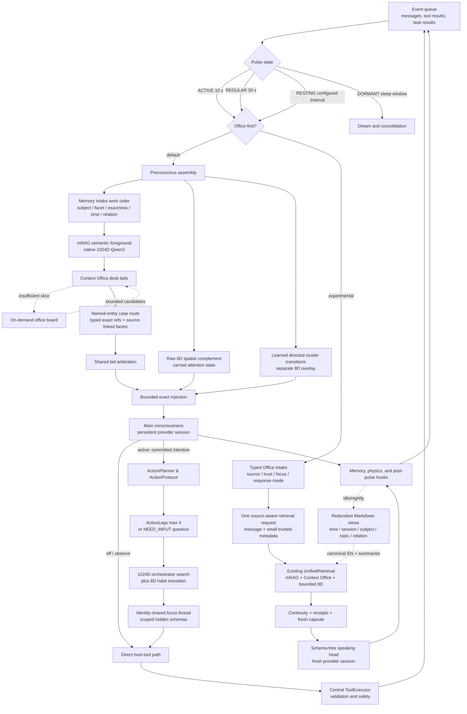

# Helix Current Technical Architecture

**Status:** current source architecture · **Mindscape source review:** 2026-10-17 · **Base branch:** `feature/typed-memory-retrieval`

This document is the shortest authoritative description of the live Helix runtime. Historical audits and benchmark reports are intentionally not updated to imitate this design; see the [documentation index](README.md) for their status.

## Explicit local mindscape composition (2026-10-17)

`setup.py --composition mindscape` selects the integration in
`core/mindscape.py`; the normal `main.py -> setup_helix -> PulseLoop` remains
authoritative. Native Helix preconscious/mRAG, Context Office and 8D physics
remain active. The adapter gestates or resumes MightyMem's `ContinualMind`
(RWKV plus the 18,016,166-parameter Habitus cortex and its graph), projects
canonical Helix memories into that graph and Context Loom, and compiles each
pulse's context through Loom.

The primary default runtime is the **Bicameral Dual RWKV-7 System** (Subconscious
recurrent mind + Speaker language model) with Learned Vocabulary Membrane Grounding.
For fallback setups, local Granite (3B or 8B) remains supported as an optional
alternative foreground language provider.

### Subconscious Motor Actuation Bridge

Rather than forcing the Speaker to emit artificial `<intention>` JSON schemas
or tool-call markup, Helix employs the **Subconscious Motor Actuation Bridge**:

1. **Subconscious Affordance Impulses**: The persistent RWKV-7 Subconscious stream
   tracks spatial and workspace affordances, emitting motor impulses through
   `OutputTrunk.DO` and `OutputTrunk.LOOK` (`core/mindscape.py::has_subconscious_motor_impulse()`).
2. **Natural Intention Parsing**: `core/mindscape_intention.py::parse_natural_or_wire_intention()`
   allows the Speaker to voice commitments naturally in conversational prose
   (e.g., *"I will check `main.py`"*), while maintaining full backwards compatibility
   with wire JSON.
3. **Native SELF Authorization & Receipts**: The native SELF kernel selects and authorizes
   the physical actuator (`open`, `sense`, `write`, `mkdir`, `move`, `run`). File
   writes require read-back verification and hash checks; Python executions capture
   stdout and exit codes within an isolated workspace. Authoritative receipts
   (`receipts.jsonl`) feed directly back into the RWKV recurrent state and Habitus
   graph.

### Functional Nursery Gestation (Pre-Contact Sandbox)

During agent initialization (`core/agent_creation.py::run_functional_nursery_gestation()`),
new agents undergo a 4-stage developmental sandbox curriculum (`core/nursery/`):
- **Stage 1 (Sensory-Motor Reflex)**: Basic reflexive feedback loops.
- **Stage 2 (Scratchpad Persistence)**: Persistent internal working memory across pulses.
- **Stage 3 (Workspace Mutation & Tool Verification)**: File manipulation, read-back verification, and execution receipts.
- **Stage 4 (Attuned Dialogue)**: Multi-turn dyadic communication and identity stability.

A comprehensive technical evaluation is generated as the **Agent Developmental Report Card**
(`developmental_report_card.txt`) and recorded in `creation.json` before live operation.

As of 2026-10-10, the standard pulse renderer uses populated source sections for
fresh messages, sensations, recalled context and internal state. The Mindscape
Loom presentation adapter additionally separates recalled human statements from
earlier unverified assistant statements. Empty sections are omitted. This is a
presentation change; improved attention and non-tool action competence remain
unverified. See the [attention diagnosis](audits/2026-10-10-attention-focus/README.md).

The Mindscape composition now also keeps retrieval input separate from rendered
context. Fresh messages/sensations/tool returns drive mRAG and Loom; only an idle
continuation uses the last complete private thought. Outward replies stay in
conversation history. mRAG retains which sentence head returned each source and
searches every nonempty sentence view in this composition. The final compositor
can place an italic `[recollection ...]` aside immediately after a uniquely
matched passage, leaving the original source unchanged in storage. A source ID,
content hash and original passage offsets accompany every placement. Unanchored
material retains conditional source headings; subjective associations and
preferences can accompany the private thought stream. Ownership and evidence
status come from records, not pronouns or retrieval scores.

This is source-aware presentation, not automatic contradiction verification.
Loom and mRAG query independently. Focus now weights admission of their nominated
material; raw mRAG similarity is not blended with Loom scores. The combined `context_assembly` receipt
accounts for Helix-supplied material alongside Loom's own admission manifest.
Private thoughts may be admitted as cognitive context, never as factual/action
evidence. The actual-launch trials have not established coherent conversation or
file-action competence. Provider-history accounting is now checked with the
installed tokenizer; document/task cursors, historical record classification and
action completion still need end-to-end validation. Details and
implementation checks are in the [context weave audit](audits/2026-10-10-context-weave/README.md).

### Activity-sensitive context and procedural knowledge (2026-10-10)

**Required architectural correction, clarified by the user:** the memory
modules have different responsibilities and must not compete directly in one
cross-module candidate ranking. Each memory function selects material within
its own role; the compositor preserves those roles and places their contributions
in the relevant parts of the context. Current focus can change their space and
placement within the selected model's physical context boundary. This does not
make a factual recollection, a subjective association and a learned procedure
interchangeable candidates. Headers alone do not establish this separation.

The new `MindscapeContextCompiler` composes independent memory-role/producer
streams. Each producer retains its own candidate order; raw similarity and
graph scores do not compete across modules. Focus priorities allocate actual
accepted token space among roles, with unused space available to other populated
roles. A rejected contribution consumes no allocation. Native trust, correction
and source-version rules remain in force. The MightyMem compiler exposes default
preserving ordering/admission hooks for this composition. Narrow regression
checks establish the selection contract; coherent product behavior still requires
the actual launcher trial. See the [context stability diagnosis](audits/2026-10-10-context-stability/README.md)
and [repair evidence](audits/2026-10-10-native-cycle-repair/README.md).

`core/context_focus.py` supplies mixed activity preferences for conversation,
action, writing, inquiry and reflection. Fresh input or the private continuation
provides lexical starting signals; recalled material cannot classify its own
next retrieval query. These are inspectable bootstrap rules, **not learned RWKV
attention**. The recurrent controller continues to own its existing modality
signals and does not acquire new action authority from these preferences.

`MindscapeContextCompiler` admits complete Helix recollections and native Loom
candidates at the same packet boundary. Section priorities change the available
space they receive through weighted admission; there are no fixed section
quotas, new result counts, or source-body truncation. Empty sections consume no
reserved allocation. Current events, private continuation, output direction,
current state and applicable ability awareness remain required. Oversize required
content raises explicitly. Optional memory exclusions retain full source and
reason receipts. Existing passage-linked recollections still use exact anchors.
The installed Granite GGUF vocabulary and its pinned chat template now count the
whole provider request, including system text and actual dialogue history. The
compiler receives only the remaining input allowance. Retrieved pulse snapshots
are transient; they never become earlier user utterances. A provider token-count
mismatch or a length-ended generation is an explicit failure, not a delivered
answer. Summaries are labeled fallible and unavailable summaries preserve the
original dialogue.

`mindscape.context_focus_profiles` overrides positive section priorities; its
resolved values, focus signals, actual section counts, total packet count and
admission decisions appear in runtime receipts. The entry point remains the
wizard and normal `main.py` pulse path; no alternate evaluation composition is
introduced.

The foreground receives relevant situation/action/outcome descriptions from
connected dispatch routes. A registered or dormant handler is insufficient.
Local API-only Ollama does not receive a claim that Gemini tools can execute its
intentions. The native profile supplies awareness from its own installed body:
move, metadata-only sense, open UTF-8/PDF text, write with read-back, mkdir, and
isolated Python execution of a hash-identified script. These use native LOOK/DO
authorization and actual returns, rather than the foreground provider's tool API.
The legacy local-tag and orchestrated routes remain separate compositions.

`ProceduralMemory` now retains immutable receipt snapshots and outcome IDs,
does not count replayed outcomes again, and requires explicit verification plus
matching runtime receipts before recommending a route. Legacy success counters
remain preserved but cannot establish supported experience. Longer verified
sequences retain references to shorter verified sequences they contain. This
relation records structural reuse, not logical entailment or proof of a more
general belief. Available supported procedures can enter the normal pulse's
procedure section; the runtime performs the evidence check without another LLM
self-validation turn. The native workspace body is now connected, but its
receipt bridge into this Helix procedural learner is still pending. Native
experience-cycle returns alone do not establish procedural promotion or RWKV
gradient learning.

See the [implementation audit](audits/2026-10-10-procedural-focus/README.md).
No post-change full-product competence result exists.

The subsequent [actual launcher recheck](audits/2026-10-10-operational-recheck/README.md)
confirmed successful wizard setup, full local initialization and message
delivery, but all four requested replies remained on an old unrelated topic.
No native file sensing, reading or script execution occurred. Two wake-up defects
were repaired; the final direct launcher initializes successfully. This is not
a functional-readiness pass, and it does not establish the cause of the attention
failure or the effectiveness of the preceding context changes.

The earlier sections below describe the underlying Helix runtime and separate
optional routes. The `mindscape` profile requires the standard preconscious
route and rejects incompatible Office-first or dual-provider settings.

## Runtime at a Glance

## Boot and Ownership

`main.py` wires one shared `MemoryManager`, `BeliefStore`, `PhysicsEngine`, `Preconscious`, `ToolExecutor`, provider configuration, and pulse loop. The standard `PulseLoop` owns the conscious provider session, event queue, serial 8D attention trajectory, memory encoding, and post-pulse hooks.

`TaskCognitionController` is attached after the standard runtime exists. Focus threads share Helix's identity, beliefs, memory corpus, semantic encoder, and host executor, but they do not move the conscious 8D attention center or teach memory associations. This avoids races and prevents parallel work from being mistaken for autobiographical attention.

`HELIX_OFFICE_FIRST=1` enables the experimental alternate path in the standard `PulseLoop`. It retains a typed mirror of each event instead of discarding source provenance during natural-language translation. A deterministic Office coordinator then uses the existing mRAG, Context Office, entity cases, belief and affect views, recent exact turns, action receipts, and one explicitly non-evidentiary 8D association to build a fresh capsule. The speaking head is a new schema-free provider session on every pulse, so no cached chat history or large identity system prompt is required. The default remains the established persistent-session preconscious path.

Each event makes one call to `UnifiedRetrieval`. The user's wording is augmented with only relevant source metadata such as sender/thread, author/audience, file path/objective, search query, or tool/task name. The existing mRAG and Context Office modules continue to own all search heads and arbitration; the runtime adapter does not reproduce either mechanism.

## Action Path & Multi-Step Task Execution

To keep Helix's main consciousness small and provider-neutral, multi-step execution uses a dedicated **Action Path**:

1. **Intention Inception:** Concrete user requests generate a durable `TaskRecord` managed by `TaskCognitionController`.
2. **Action Leg Planning (`ActionPlanner`):** Generates at most **4 outcome-oriented legs** (`ActionLeg`) or asks **one material clarification question** (`NEED_INPUT:`).
3. **Context Budgets:**
   - Planner task text ≤ 300 tokens
   - Scoped context ≤ 400 tokens
   - Observation size ≤ 600 tokens per step
4. **Execution Protocol & Verification (`ActionProtocol`):**
   - File mutations require a matching read-back step.
   - Browser and GUI operations require subsequent DOM observation or screenshot.
   - Terminal and git actions require explicit observer confirmations.
5. **Procedural Learning:** Verified execution paths are recorded into `ProceduralMemory`; unverified or failed legs generate cautionary lessons for future routing.

## Pulse State Machine

| State | Default cadence | Transition behavior |
|---|---:|---|
| `ACTIVE` | 10 seconds | Entered by an incoming user or critical event |
| `REGULAR` | 30 seconds | Entered after 2 minutes without incoming activity |
| `RESTING` | 15 minutes, config-overridable | Entered after 10 minutes in `REGULAR`; wakes immediately for events |
| `DORMANT` | 60-second wake check | Entered during the configured sleep window; runs nightly dream work |

## Preconscious Retrieval Contract & Typed Record Envelopes

Retrieval is separated into semantic advice, a deterministic Context Office evidence brief, and bounded non-semantic complements.

All canonical journal memories are decorated at runtime with a `RecordEnvelope` (`memory/record_envelope.py`) that classifies record kinds (`thought`, `inbound_message`, `outbound_message`, `tool_call`, `tool_result`, `task_outcome`), supporting assertions, and verification status without rewriting stored `.jsonl` files.

| Order | Lane | Representation | Contract |
|---:|---|---|---|
| 1 | Memory intake | Deterministic query work order | Removes transport framing and identifies named subjects, requested facets, exactness, chronology, and relational scope |
| 2 | Layer-2 anchors | Named people, concepts, skills, desires | Exact high-priority anchors with repetition guard |
| 3 | mRAG semantic advisor | Native normalized 1024D Qwen3 embeddings | Full-trigger, sentence, RAKE, entity, concept, and relation heads plus exact-term/tag evidence |
| 4 | Maintained text views | Redundant Markdown logs by time, session, subject, topic, and relation | Copies retain one canonical memory ID; deduplicated by ID |
| 5 | Context Office | Specialist desks over canonical memory | Facts, State, Relations, Catalog, Case, Beliefs, Causality, Affect, and Identity desks submit bids |
| 6 | Raw spatial / Lateral desk | MiniLM 384D projected to 8D | At most two spatial-only items; non-evidentiary |
| 7 | Associative transition | Directed cluster prototypes in separate 8D overlay | Surfaces lateral follow-ons based on repeated attention transitions |
| 8 | Working state | Stability, Lagrangian snapshot, scratchpad | Preserved for somatic echo and rendering |

## Subconscious Inquiry Dreaming & Gravitational Tension Queue

During nightly DORMANT phases or voluntary sleep cycles, the Curator processes belief clusters using a **Gravitational Tension Queue**:
- **Tension Queue Sorting:** Clusters are evaluated by mean 8D binding gravity ($\vec{g}$) and sorted densest-first, with the queue capped at the top 5 eligible candidates.
- **Subconscious Reflection Inquiries:** Replaces generic summaries with targeted subconscious inquiry prompts (*"What information can be gleaned, or what conclusions, if any, can be drawn from the following belief fragments?"*).
- **Meta-Prefix Sanitization:** LLM output parsing strips conversational intros (`"what information can be gleaned is..."`) to ensure clean Layer-2 concept anchors.

## Somatic Engine & Voluntary `sleep` Tool

To support non-linguistic internal state perception and autonomous sleep cycles:
- **Somatic Engine (`core/somatic_engine.py`):** Expresses internal fatigue and cognitive tension via non-language **Somatic Tokens** (`SOMATIC:FATIGUE_HIGH`, `COGNITIVE:TENSION_HIGH`, `IMPULSE:REST_SUGGESTED`).
- **Voluntary `sleep()` Internal Tool (`tools/internal_sleep_tool.py`):** Allows the agent to initiate a sleep/consolidation cycle when experiencing high cluster tension or fatigue. Returns a verified **Somatic Confirmation Receipt** (`[somatic receipt: voluntary sleep cycle executed...]`) that resets fatigue metrics without interrupting the conversational flow.

## Dual-Manifold Physics Substrate

Helix's physical memory dynamics operate on a dual-manifold architecture:
- **Static Spatial Manifold:** Standard 384D/8D physical spatial embeddings for episodic memories and belief clusters.
- **Fluid Habitus Graph Manifold (`core/habitus_graph_manifold.py`):** Tracks dynamic real-time graph node/edge activations $\vec{a}_t$.
- **Temporal Hedonic Resonance $W(e)$:** Habitually matches current graph activation signatures against historical positive-valence memories over time, delivering non-conscious preference nudges (`(subconscious preference: familiar positive graph pathway — valence +0.85)`) to guide trajectory without forcing rigid logic.

## Provider Ecosystem

| Provider | Intended use | Tool behavior |
|---|---|---|
| `codex_cli` / `codex` | Continuous Helix consciousness via ChatGPT-authenticated Codex App Server | Host-mediated constrained actions; thought-only main session |
| `claude_cli` | Continuous API/subscription consciousness | Native CLI tool pass execution |
| Gemini | Continuous API-backed consciousness | Provider-native function calling through `ToolExecutor` |
| Anthropic | Continuous API-backed consciousness | Provider-native tool use through `ToolExecutor` |
| Ollama | Local consciousness | Local text/tool-dispatch compatibility path |
| llama.cpp | Local GGUF consciousness | Local GGUF compatibility path |

## Persistence Map

| Data | Location | Update model |
|---|---|---|
| Episodic/thought journal | `data/memory/cognitive_journal.jsonl` | Append-only events with sidecar compaction |
| Record Envelopes | Dynamically computed overlay | Standardized evidence assertions and typed metadata |
| Belief categories | `data/beliefs/*.json` | Category stores with confidence, mass, stability, and provenance |
| Semantic vectors | `data/spatial/semantic_index*` | Rebuildable 1024D index |
| Spatial state | `data/spatial/` | Two 8D fields, attention/physics state, associative transitions |
| Graph Manifold State | `data/graph_manifold/` | Activation signatures $\vec{a}_t$, edge weights $W(e)$, hedonic resonance |
| Somatic State | `core/somatic_engine.py` | Fatigue scores, tension metrics, somatic receipts |
| Scratchpad | `data/scratchpad/` | Explicit working notes |
| Task cognition | `data/tasks/` | Atomic task records, action plans, procedures, and orchestrators |
| Entity cases | `data/cases/office_board.json` | Source references and session membership |
| Interaction ledger | `data/interaction_ledger.json` | Action provenance records |

For implementation and operator details, see [SYSTEM_MANUAL.md](../SYSTEM_MANUAL.md) and [Action Path Contract](action_path.md).
