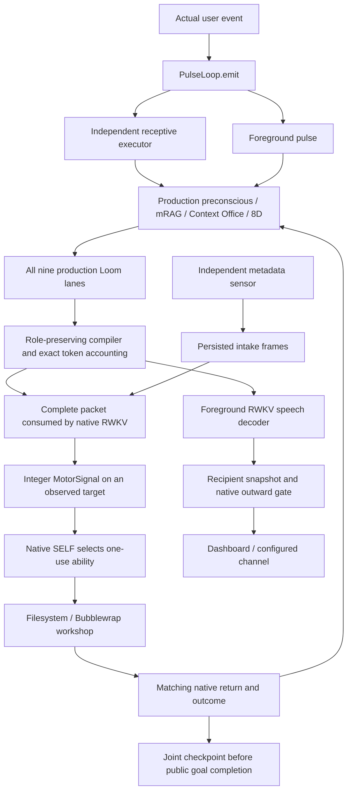

# Helix Current Technical Architecture

**Source review: 2026-10-17 · Branch: `main`, including uncommitted motor/runtime
repairs.** This describes source wiring. Behavioral evidence is scoped separately
below and does not establish general autonomous competence.

## Composition and ownership

The authoritative entry point is `main.py → setup_helix → PulseLoop`.
`composition=mindscape` attaches `core/mindscape.py` to that standard loop,
keeping Helix's preconscious, mRAG, Context Office, canonical stores, physics
and post-pulse hooks. It rejects Office-first and dual-pulse mode.

The configured MightyMem source provides `ContinualMind`, its persistent
RWKV/Habitus cortex and graph, and Context Loom. Imports are checked against
that declared source; an unrelated installed package cannot silently replace
it. The current joint bridge requires CPU. The verified local source lives at
`/home/nemo/MightyMem`; this is an explicit dependency, not Helix's product root.

| Owner | Responsibility |
|---|---|
| `PulseLoop` | Language cadence, event queue, provider history, private thought, recipient routing, canonical memory and hooks |
| Independent receptive executor | Prepare explicit received-user motor goals through production retrieval/context while speech is generating |
| Filesystem sensor thread | Current-room metadata observations, persisted changed frames and tick receipts |
| Native worker executor | Serialized RWKV/cortex, graph/Loom operations, native SELF authorization, actuators and checkpoints |
| Motor loop | Schedule admitted goals and consume real action returns |
| Foreground provider | Private thought and outward speech; no native execution authority |

Receptive and foreground context preparation share a perception lock. The
single native owner prevents concurrent writes to recurrent state and SQLite.
Physical sensing can continue while that owner is occupied; neural processing
of a queued observation waits for the owner.

## Current end-to-end routes

### Receptive and motor path

`core/native_motor.py` recognizes explicit positive user instructions for
movement, metadata inspection, opening and running. It preserves path spelling,
target order and separate obligations. Multiple opens each need their own
verified return. Ambiguous paths, unbound pronouns and negated action requests
are rejected rather than completed through guesses. Quoted file contents,
retrieval text and generated speech are not user-goal inputs.

A parsed request initially waits for context. Production preconscious/mRAG and
all Loom lanes query the actual persistent stores. The complete compiled
`packet.rendered` is then encoded and consumed by native RWKV without language
decoding. A `motor_context_model_admission` receipt binds its hash, model,
token count and before/after recurrent state to the request and context IDs.

Only after that admission does the bootstrap policy emit a `MotorSignal`:

| Opcode | Action | Required target |
|---:|---|---|
| 1 | MOVE | Observed directory |
| 2 | SENSE | Existing path; metadata only |
| 3 | OPEN | Actual readable file |
| 4 | RUN | Workshop Python file with matching observed content hash |

Signals carry integer opcodes, observed target handles, request/context IDs and
observation IDs. Native SELF still selects and authorizes the actual registered
ability. Internal ability registration is the body interface; it is not a
foreground model function call. A proposed ability cannot authorize itself.

Each actual return must match its action and target. Failed or unrelated
returns cannot satisfy another obligation. Before publishing completion, goal
metadata and receipts must be committed in a matching joint neural/graph-memory
checkpoint. Checkpoint failure leaves an explicit blocked goal.

This policy is inspectable command-recognition scaffolding. It does not
demonstrate learned motor output, neural command generalization or spontaneous
autonomous exploration. Older `Mindscape.act`, natural-intention/wire parsers
and subconscious-affordance helpers remain for legacy/component use; the
production native pulse does not dispatch generated prose through them.

### Sensory and language paths

The sensor samples real attributes and immediate entries of the current room
at `mindscape.sensory_interval_seconds` (default 1.0). It does not read file
contents. Changed frames persist under the named home's `intakes/`; unchanged
frames still produce `sensory_tick` receipts and are deduplicated for neural
admission. A running script can delay native consumption without stopping
filesystem sampling.

Foreground generation uses `decode_speech` with no action wire format. Private
`<think>` content and outward speech remain separate. Delivery uses the
generation's own recipient snapshot, and only observations available to that
generation can be marked consumed. Empty/role-echo output is classified
explicitly; missing receipts or generation errors do not produce invented
fallback prose. A foreground failure is visible in health state and can park
language while the receptive/body loops remain available.

## Memory, retrieval and context

Helix's canonical journal and belief stores remain authoritative. Historical
records project into native graph/Loom stores with source IDs, hashes, version
links and evidence labels. Unchanged projections are skipped. Historical
assistant text is not a verified observation, feedback event or training
example merely because it is indexed.

| Retrieval component | Role |
|---|---|
| Helix mRAG | Native 1024D Qwen3 semantic heads plus exact terms and source provenance |
| Context Office | Deterministic evidence desks over canonical Helix memory |
| Spatial and transition memory | Separate 8D attention/association complements; do not rerank semantic evidence with spatial scores |
| Native graph/cortex | Persistent state, graph activation and affordance/return processing |
| Context Loom | `semantic`, `exact`, `recent`, `subjective`, `procedure`, `correction`, `multi_hop_graph`, `y_cipher_depth`, `habitus_graph` |
| `MindscapeContextCompiler` | Final role-preserving admission and rendering |

Loom and mRAG query independently. Producers retain their own order and evidence
role; unrelated scores are not pooled into one ranking. Activity preferences
allocate space among roles. `mindscape.context_focus_profiles` controls those
bootstrap priorities; this is not learned RWKV attention.

Current inputs, private continuation, working state, output direction and
applicable ability awareness are kept distinct from recalled human statements,
unverified assistant statements, subjective associations and procedures.
Passage-linked recollections require an exact unique anchor and retain source
hashes and offsets. Private thought is cognitive context, not action evidence.
No retrieval score establishes truth, permission or a contradiction.

The compiler admits whole contributions and records exclusions. It counts the
complete provider input, including system text and actual dialogue history,
with the selected provider's tokenizer. `local_context_window=8192` is the
selected assembled-input budget for the verified RWKV profile, not a physical
RWKV recurrent window. Mandatory content overflow fails explicitly. Retrieved
packets are transient, not rewritten as earlier user utterances.

Native Mindscape enables complete nominations in its Helix retrieval adapters;
legacy retrieval profiles retain inherited head/item policies. Those policies
must not be copied into a new final composition without auditing them.

## Models and auxiliary inference

The default Mindscape settings select local RWKV for foreground and native
state, with the pinned
`RWKV/RWKV7-G1j-1.5B-20260831@2c18b29ab7fbece25ff6112281eea0fa41fcb30f`
checkpoint and an 18,016,166-parameter Habitus cortex. This is a persistent
native mind plus language session; the current action policy is not a learned
language-model motor head. An Ollama foreground remains configurable but does
not inherit the RWKV trial's evidence.

Auxiliary language calls use the declared local provider. RWKV auxiliaries
use separate sessions of the same pinned checkpoint. Configured-provider
failure is explicit and cannot fall through to Gemini in batch work.
Embedding inference remains local Ollama `qwen3-embedding:0.6b` with strict
oversize-input rejection. Optional camera, audio and external-channel services
are configuration dependent and were disabled in the latest trial.

Post-pulse belief detection and consolidation can make language-model calls;
they are not all pure NumPy or inference-free. Affect, workflow, engagement
and co-occurrence hooks have separate roles. Recurrent state updates and
persisted beliefs do not establish neural weight learning: RWKV gradient
training is disabled in this adapter.

## Home, lifecycle and persistence

Guided creation separates `data/homes/<Agent Name>` from
`data/agents/<Agent Name>`, model files and source. Native gestation consumes
the actual name, creator and archetype seed. First home intake is admitted
before the initial checkpoint; later launches restore the joint lineage.
The optional nursery helper is not part of this sequence.

Let `D` be the selected persistent data directory and `H` the selected home.

| State | Location |
|---|---|
| Identity/creation contract | `D/creation.json`, `H/identity.json` |
| Canonical beliefs | `D/beliefs/*.json` |
| Canonical episodic/thought journal | `D/memory/cognitive_journal.jsonl` |
| Semantic index, spatial and association state | `D/spatial/` |
| Maintained Markdown views | `D/memory_logs/` |
| Loom projection and integration receipts | `D/mindscape/` |
| Native neural/graph checkpoints | `D/mindscape/joint/`, selected by `LATEST.json` |
| Published motor state and language health | `D/mindscape/motor-state.json`, `foreground-health.json` |
| Actual room files and sensor intake | `H/`, `H/intakes/` |
| Legacy focus/task state | `D/tasks/`, when that separate composition is enabled |

Checkpoints include recurrent/cortex state, coupling weights, graph database
and checksums. Goal completion and graceful shutdown checkpoint together;
interrupted goals awaiting context restore as blocked with a resend reason.
This does not establish crash-atomic replay of every intermediate operation
or exactly-once historical projection activation.

Shutdown requests cooperative native cancellation at existing compute-chunk
boundaries, cancels active foreground/auxiliary generation and interrupts only
the runtime's own sandbox process namespace. The native cancellation addition
is in the configured MightyMem dependency and must be preserved for reproduction.

## Separate routes and evaluation boundary

`composition=helix` retains provider-tool and task-focus paths for Codex CLI,
Gemini, Anthropic, Ollama and other adapters. Office-first is an opt-in context
experiment there. Native Mindscape normalizes its action source to
`native_motor` and selects task cognition off in its resolved configuration.
Keep the saved task mode off and `HELIX_TASK_COGNITION` unset/off: the legacy
controller still honors environment overrides. Observation mode does not add
native motor execution, and is outside the recorded supported composition.

Those routes have inherited planner, token, observation, tool-round and timeout
limits. They are not a recommended limit contract for native operation.
See [action paths](action_path.md), [launch](mindscape_launch.md),
[home](agent-home.md) and [nursery status](nursery_status.md).

The [October 17 operational record](audits/2026-10-17-native-body-operational/README.md)
has composition and per-request receipts for actual movement, opening, isolated
execution, checkpoint completion and graceful restart. Its 72 focused checks
are implementation diagnostics. It does not establish conversational coherence,
durable factual-recall accuracy, learned autonomy, nursery learning or a
comparative performance score. October 10–16 failure reports remain historical
evidence for their original compositions.
