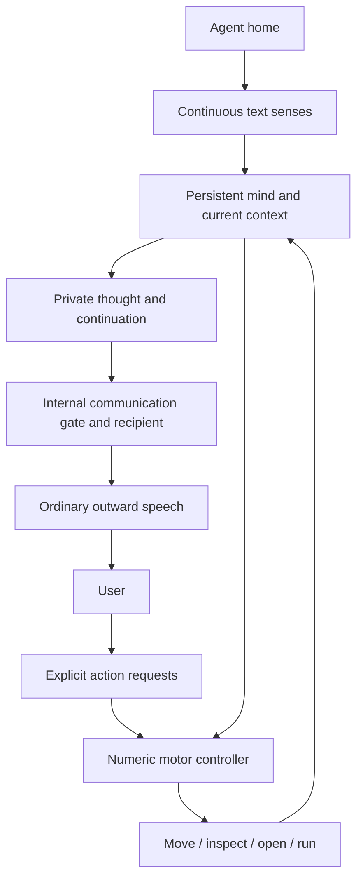

# Sensing, action and speech

Helix gives its agent a persistent digital body and two ways to express its
state: actions in its home and speech to a person. A continuous sensory stream
keeps its immediate environment available while it thinks and works.

## Sense the surroundings

The agent's home is a real directory with rooms such as `thinking`,
`workshop` and `bedroom/closet`. A background sensor observes the current room
and its immediate entries. Names, file types, sizes and modifications form a
text view of the surroundings. Opening a file brings its contents into view.

Changed observations are saved in `intakes/` and queued for the native mind.
The sensor keeps sampling during language generation or a running experiment;
the mind admits queued observations when its worker is available. This gives
the agent fresh surroundings without requiring it to emit a “look” tool call
for each update.

## Act through the body

The current controller accepts explicit requests through Chat:

```text
Please sense .
Please go to /workshop.
Please open /staging/Notes.txt.
Please go to /workshop then open Example.py then run it.
```

Requests pass through the agent's memory, context and native RWKV intake.
The controller then issues numeric motor signals bound to actual targets,
and native SELF authorizes the body operation. The foreground language model
does not have to generate tool-call syntax.

A real action returns a real observation: the current room, file contents,
script output or an error. The controller tracks each requested target and
saves completed work with the persistent mind. Dashboard **Environment and
actions** shows these results alongside the conversation.

Put scripts in `workshop/` before requesting execution; Dashboard uploads
initially land in `staging/`. Running a script checks its observed hash and
automatically starts the workshop sandbox. The experiment can create workshop
artifacts while source code, other rooms and mind stores remain outside the
sandbox. See [the home guide](agent-home.md) for containment details.

## Think privately and speak without a command

Speech has its own route. The language stream can produce private contemplation,
ordinary outward prose, or private contemplation followed by that prose.
Private content stays in the thought/continuation path; the communication
route delivers the outward text.

The native communication state supplies the outward signal, and routing
identifies the recipient and channel. The model does not need to write
`[SPEAK: ...]`, `{"action":"speak"}` or a function call to change from
thinking to speaking. Ordinary prose is sufficient when delivery is enabled.
The internal route called `SPEAK` is a controller signal, not a required
language command.

A thought-only pulse preserves the pending interaction. Later pulses can
continue the thought and reply to the same person. An outward impulse without
a resolved recipient stays internal. Entering the `thinking/` room is
navigation; it is not a prerequisite for private thought or speech.

Speaking and acting use separate outputs. A sentence about opening a file
does not actuate the body. A motor return supplies the actual file contents
that the agent can use when it speaks.

## How the paths connect



## Current support

Movement, opening, sandboxed execution and graceful restart have
[recorded live CPU evidence](audits/2026-10-17-native-body-operational/README.md).
A separate live control captured surroundings changes while a script was
running. Thought/speech separation, pending-interaction continuity and delivery
routing are implemented and covered by focused checks; the body workflow
was not a conversation-quality evaluation.

The action policy currently follows explicit user goals. Learning to select
and sequence actions independently is the next stage. Chat exposes move,
sense, open and run; other module handlers and the nursery have their own
integration status.

For implementation details, see [architecture](architecture_current.md),
[action paths](action_path.md) and the [test guide](../tests/TEST_SUITE_README.md).
