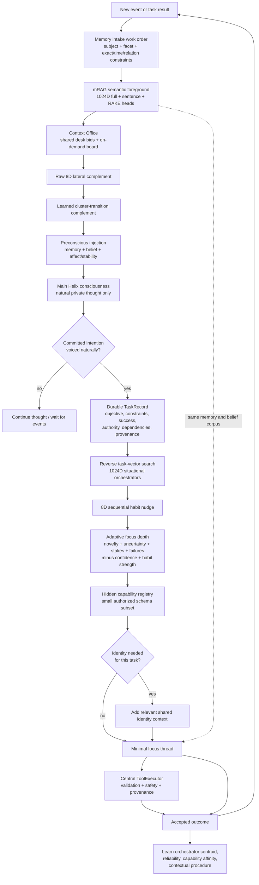

# Helix Event-Driven Task Cognition

**Scope: separate legacy Helix focus-worker route · Reviewed: 2026-10-17.**

This is not the current native Mindscape motor pipeline. Mindscape normalizes
its action source to `native_motor`; its supported configuration keeps task
cognition off. Keep `HELIX_TASK_COGNITION` unset/off because the legacy controller
honors this override. Generated speech cannot start native actions.
See the [current action path](action_path.md)
and [architecture](architecture_current.md). The diagram below describes the
retained task/focus implementation rather than learned autonomous motor output.

This layer replaces “show the main model every tool and tell it exactly how to
behave” with a small cognitive kernel and learned runtime structure. It is
additive to mRAG and the non-semantic spatial lanes.

The main pulse is the only owner of conscious 8D attention movement and
cluster-transition learning. Parallel focus threads query the shared mRAG
corpus without moving or reinforcing that trajectory. This keeps task work
from becoming a false autobiographical association merely because it ran in
parallel.

The focus kernel is task-dependent. Ordinary lookup, calculation, and tool
work receive no “You are Helix” line. Identity is included only when the task
depends on selfhood, values, personal history, relationships, preferences, or
characteristic behavior. Local-context focus sessions expose at most four
capability schemas; 100k+-context sessions expose at most eight.

The capability counts, adaptive focus depths and task/context ceilings in this
route are inherited implementation policies. They are not justified native
product constraints; audit their interactions before any full-system evaluation.

## Lifecycle

`CREATED → FOCUSING → EXECUTING → REFLECTING → COMPLETE`

Tasks can instead become `BLOCKED`, `FAILED`, or `CANCELLED`. Interrupted
non-terminal tasks return to `CREATED` at the next pulse. Dependencies must be
complete before a focus thread can claim a task.

`observe` is the migration mode: it builds a real audit of Helix's naturally
formed intentions without changing action execution. `active` makes the main
provider thought-only and moves task completion to bounded focus threads.
